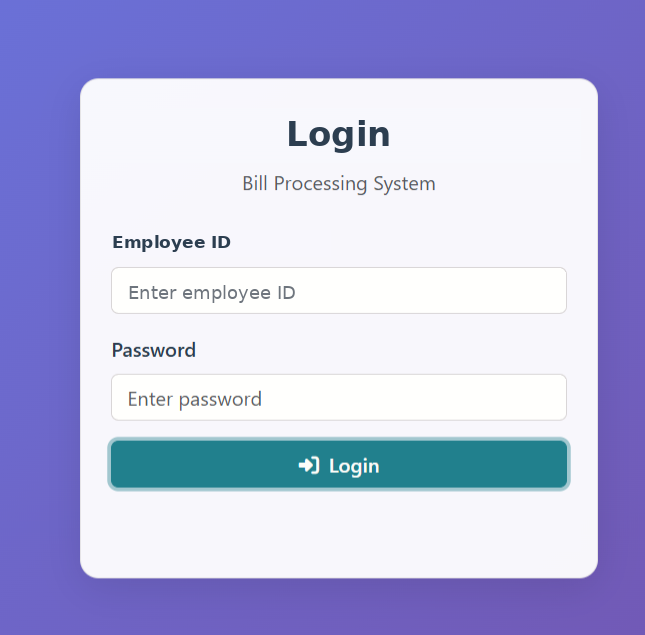
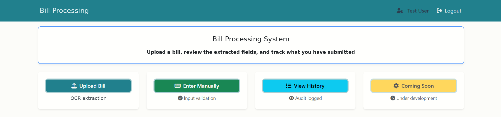
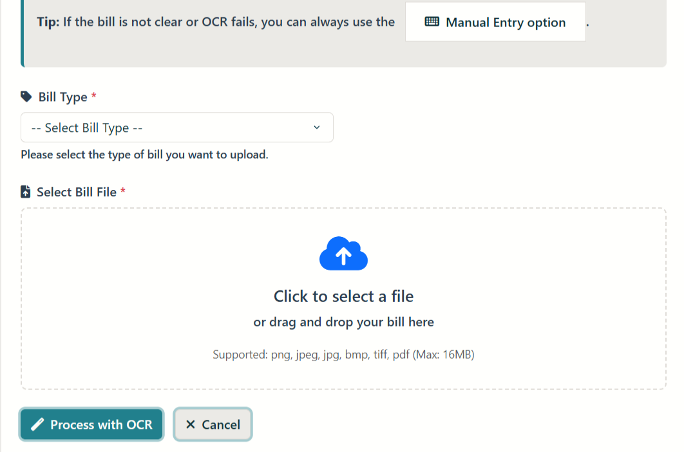
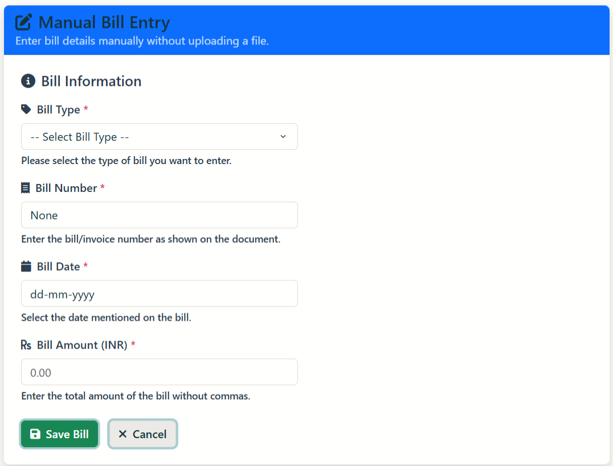
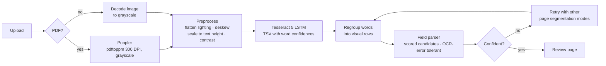
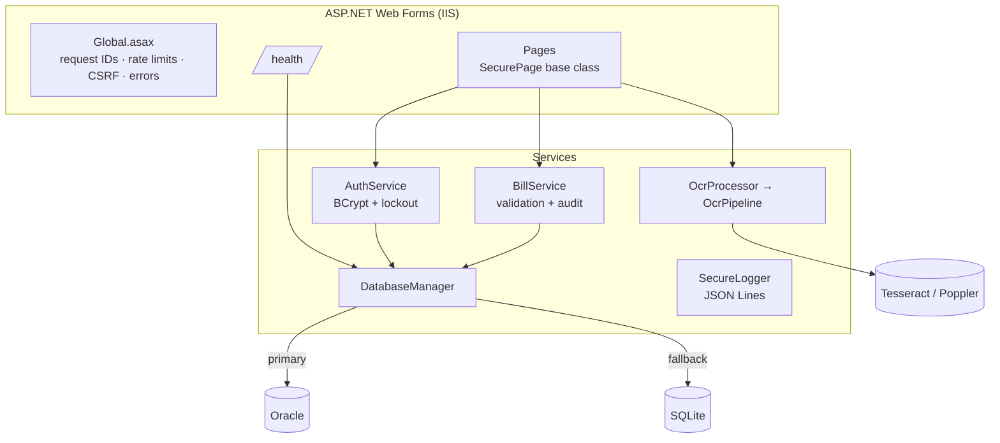

# BillLens


**BillLens** is a web application for submitting reimbursement bills. Upload a scanned bill or a phone
photo (PDF, JPG or PNG); BillLens reads the **bill number, date and total** with OCR, flags anything it
isn't sure about, and lets you correct it before saving. Bills can also be entered by hand, and every
action is audited.

The interesting part is the OCR pipeline. On a held-out benchmark of 200 synthetic bills it extracts all
three fields correctly for **77.5%** of bills (the original regex-on-raw-OCR approach managed 1%), and
for **90–100%** of bills that are anything short of badly degraded. When it marks a field as confident,
that field is right **95.8%** of the time. See [Benchmark](#ocr-benchmark).

## Screenshots

These show the **early prototype (mid-2025)**: the same sign-in → choose an action → upload with OCR / enter
manually workflow, before the redesign. The current pages share one navigation bar and add confidence badges on
the review page.

| Sign in | Home |
|---|---|
|  |  |
| **Upload a bill for OCR** | **Manual entry** |
|  |  |

## Contents

- [Screenshots](#screenshots)
- [Features](#features)
- [How the OCR works](#how-the-ocr-works)
- [OCR benchmark](#ocr-benchmark)
- [Architecture](#architecture)
- [Getting started](#getting-started)
- [Configuration](#configuration)
- [Security](#security)
- [Rate limiting, logging and health checks](#rate-limiting-logging-and-health-checks)
- [Database](#database)
- [Tests and CI](#tests-and-ci)
- [Technology choices](#technology-choices)
- [Limitations and next steps](#limitations-and-next-steps)

## Features

- **Upload and read:** PDF (first three pages, rendered at 300 DPI), JPG and PNG up to 5 MB.
- **Review before saving:** extracted values are shown in an editable form. Fields that were hard to read
  are highlighted, and a total that matches sub-total + tax is marked as verified.
- **Manual entry** for bills without a file.
- **Bill history** with totals, per user.
- **Audit log** (admins): sign-ins, sign-outs, lockouts, saved bills and history views.
- **Oracle with automatic SQLite fallback:** if Oracle is unreachable the app keeps working on SQLite and
  retries Oracle after 5 minutes.

## How the OCR works



All OCR code is in [`bills_project/Services/Ocr`](bills_project/Services/Ocr) and
[`BillTextParser.cs`](bills_project/Services/BillTextParser.cs). It has no dependency on System.Drawing or
ASP.NET, so the same code runs in the web app, the unit tests and the benchmark.

**1. Image preprocessing** (`ImagePreprocessor.cs`)
- *Lighting:* the paper colour is estimated across the page (max filter on a downsampled copy, then
  smoothed) and divided out, so shadows and gradients from phone photos disappear.
- *Deskew:* projection-profile search. Dark pixels are rotated by candidate angles (±6°, coarse then fine)
  and the angle whose row histogram is spikiest wins.
- *Scale:* Tesseract's LSTM model reads best at a particular text size. Text-line height is measured from
  bands of ink (each row smeared sideways first so noise averages out), and the page is resized so lines are
  about 34 px tall. Small, low-resolution photos are enlarged up to 4×.
- *Contrast:* percentile stretch. Binarisation is left to Tesseract, which does it far better on the
  cleaned image.

**2. Recognition** (`TesseractRunner.cs`, `TesseractTsv.cs`). Tesseract runs asynchronously with a timeout,
LSTM engine only, and returns TSV: every word with its position and confidence. Words are regrouped into
visual rows by vertical position, so `Grand Total ........ 1,240.50` stays on one line even when Tesseract
puts the amount in a separate block.

**3. Field extraction** (`BillTextParser.cs`). Each field is chosen from scored candidates rather than taken
from the first regex match:
- *Labels survive OCR errors:* tokens are normalised (`T0tal` → total, `lnvoice` → invoice,
  `Arnount` → amount) and matched with edit distance.
- *Numbers survive OCR errors:* look-alike letters inside numbers are fixed (`1,18O.OO` → 1180.00).
- *Distractors are scored down:* due dates, "printed on" dates, sub-totals, tax lines, item prices, and
  account or consumer numbers.
- *Formats:* day-first dates in five numeric styles plus month names (`12 Aug 2024`, `Aug 12, 2024`), and
  Indian or international digit grouping with `Rs.`, `₹` or `INR`.
- *Arithmetic check:* if sub-total + tax equals a candidate total, that candidate wins and is marked as
  verified. If a currency sign was read as a digit (`₹28,812.86` → `728,812.86`), the arithmetic shows which
  digit to drop.
- *Per-field confidence (0–1)* combines label strength, the validation checks and Tesseract's own word
  confidence. It drives the "check" badges on the review page.

**4. Multi-pass.** Page segmentation mode 6 (uniform block) runs first. Only if the result isn't confident
are modes 4 (single column) and 11 (sparse text) tried, and the best-scoring result is kept. Clean bills
take one pass.

## OCR benchmark

Real bills contain personal data, so accuracy is measured on **synthetic bills with known answers**.
[`tools/ocr-benchmark/generate_bills.py`](tools/ocr-benchmark/generate_bills.py) renders receipts, invoices,
utility bills and pharmacy bills in several fonts, with realistic distractors. It then degrades them at four
levels, from clean scans to low-resolution, rotated, blurred, noisy, unevenly lit, JPEG-compressed phone
photos. [`tools/OcrBenchmark`](tools/OcrBenchmark) runs the original pipeline and the current one on the same
images and scores exact matches.

The pipeline was tuned on a development set (seed 7). The numbers below are from a separate held-out set of
200 bills (seed 2026), using Tesseract 5.3.4. Full tables are in
[docs/ocr-benchmark-results.md](docs/ocr-benchmark-results.md).

| Degradation | Bills | Original: all 3 fields correct | **BillLens: all 3 fields correct** | Bill no. | Date | Amount |
|---|---:|---:|---:|---:|---:|---:|
| Clean | 52 | 1.9% | **100%** | 100% | 100% | 100% |
| Mild | 52 | 0% | **96.2%** | 100% | 100% | 96.2% |
| Moderate | 48 | 2.1% | **89.6%** | 97.9% | 93.8% | 95.8% |
| Heavy | 48 | 0% | **20.8%** | 31.3% | 52.1% | 39.6% |
| **All** | 200 | 1.0% | **77.5%** | 83.0% | 87.0% | 83.5% |

- **Field accuracy:** 27.3% → **84.5%**.
- **Calibration:** fields marked confident (≥ 0.6) are correct 95.8% of the time. Fields marked unsure are
  correct only 5% of the time, which is why the review page highlights them.
- **Speed:** about 0.5 s per bill (1.1 s for heavily degraded ones, which need extra passes).
- **"Heavy"** is deliberately extreme: text about 8 px tall, blurred, noisy and JPEG-compressed. Most of
  those bills are hard for a person to read too.

CI regenerates 100 held-out bills on every push and fails the build if field accuracy drops below 75%.

Reproduce locally (needs Python with Pillow, the .NET 10 SDK and Tesseract):

```
python tools/ocr-benchmark/generate_bills.py --count 200 --seed 2026 --out tools/ocr-benchmark/test
dotnet run -c Release --project tools/OcrBenchmark -- --data tools/ocr-benchmark/test --mode both
```

## Architecture



```
bills_project.sln
├── bills_project/                 the web application (.NET Framework 4.8, ASP.NET Web Forms)
│   ├── App_Config/                configuration access (AppSettings)
│   ├── App_Data/                  secrets, SQLite database, uploads, logs (never served by IIS)
│   ├── Infrastructure/            SecurePage, rate-limit gate, request IDs, health check
│   ├── Pages/                     Login, Home, Upload, Review, ManualEntry, View, Audit, Error
│   └── Services/                  database, auth, logging, rate limiting, bill parsing
│       └── Ocr/                   preprocessing, Tesseract runner, TSV parsing, pipeline
├── tests/BillsProject.Tests/      xUnit tests (108), run on .NET 10 and .NET Framework 4.8
├── tools/
│   ├── ocr-benchmark/             synthetic bill generator (Python)
│   └── OcrBenchmark/              accuracy benchmark (.NET 10)
├── db/oracle/schema.sql           Oracle tables, indexes, stored procedure, least-privilege grants
└── docs/                          benchmark results
```

## Getting started

**Requirements:** Windows with Visual Studio 2022 or later (*ASP.NET and web development* workload),
[Tesseract OCR 5](https://github.com/UB-Mannheim/tesseract/wiki), and
[Poppler](https://github.com/oschwartz10612/poppler-windows/releases) for PDFs. Oracle is optional.

1. Clone the repository and open `bills_project.sln`.
2. Restore NuGet packages.
3. Check `TESSERACT_PATH` and `POPPLER_PATH` in `bills_project/Web.config`.
4. Press **F5**. On first run the app creates `App_Data/bills.db` with the schema and demo data.
5. Sign in with a demo account. These exist only while `SEED_DEMO_USERS=true`; Release builds turn it off.

   | Employee ID | Password | Role |
   |---|---|---|
   | `test123` | `password123` | user |
   | `admin123` | `admin123` | admin (sees the audit log) |

**Using Oracle:** run [`db/oracle/schema.sql`](db/oracle/schema.sql), create the least-privilege app user
described at its end, then copy `bills_project/App_Data/secrets.config.example` to `secrets.config` and fill
in that user's credentials. `secrets.config` is gitignored.

## Configuration

Settings live in `bills_project/Web.config` → `<appSettings>`:

| Key | Default | Purpose |
|---|---|---|
| `ORACLE_DSN` | `localhost:1521/freepdb1` | Oracle server (credentials go in `App_Data/secrets.config`) |
| `USE_SQLITE_FALLBACK` / `SQLITE_DATABASE` | `true` / `App_Data/bills.db` | fallback database |
| `SEED_DEMO_USERS` | `true` (Release: `false`) | create demo logins in an empty database |
| `MAX_CONTENT_LENGTH_MB` / `ALLOWED_EXTENSIONS` | `5` / `.png,.jpg,.jpeg,.pdf` | upload limits |
| `TESSERACT_PATH` / `POPPLER_PATH` / `OCR_TIMEOUT` | install paths / `30` s | OCR tools |
| `RATE_LIMITS` | `general:120 per minute,login:10 per minute,upload:10 per minute,save:20 per minute` | request limits |
| `LOGIN_LOCKOUT` | `5 per 15 minutes` | failed logins before an account is locked |
| `LOG_LEVEL` / `LOG_DIRECTORY` | `INFO` / `App_Data/logs` | logging |

`Web.Release.config` applies production settings on publish: HTTPS-only cookies, HSTS, custom error pages,
no debug compilation, no demo users.

## Security

- **Passwords:** BCrypt, cost factor 12. Unknown accounts take as long to reject as wrong passwords, so
  timing doesn't reveal which IDs exist.
- **Brute force:** an account is locked for 15 minutes after 5 failed logins; each IP is limited to 10 login
  attempts a minute.
- **CSRF:** view state is tied to the session (`ViewStateUserKey`), and every POST must carry an anti-CSRF
  cookie matching the session.
- **Sessions:** each session is bound to the signed-in user, and the CSRF token is replaced at login.
  Cookies are HttpOnly and SameSite.
- **Uploads:** extension allow-list, size limit, and a file-signature check (the bytes must really be a PDF,
  PNG or JPEG). Files are stored under random names in `App_Data`.
- **SQL:** bound parameters everywhere.
- **Output and errors:** everything shown is HTML-encoded. Error pages show fixed messages and a reference
  ID; details go only to the server log.
- **Headers:** Content-Security-Policy (no third-party sources; all libraries are served locally),
  X-Frame-Options, X-Content-Type-Options, Referrer-Policy and Permissions-Policy. Server and version
  headers are removed. HSTS is on in Release.
- **Secrets:** database credentials are kept in a gitignored file, not in `Web.config`.

Reporting a vulnerability: see [SECURITY.md](SECURITY.md).

## Rate limiting, logging and health checks

- **Rate limiting:** an in-memory, thread-safe sliding-window limiter
  ([`RateLimiter.cs`](bills_project/Services/RateLimiter.cs)).
  - Limits apply per IP (all pages, login attempts) and per user (uploads, saves).
  - Blocked page requests get **429** with `Retry-After`.
  - Counts are kept per worker process; a web farm would need a shared store such as Redis.
- **Structured logging:** JSON Lines in `App_Data/logs/app-YYYYMMDD.log`, plus `security-YYYYMMDD.log` for
  security events.
  - Every line carries a request ID, user, IP and path.
  - The same ID is returned in the `X-Request-ID` header and shown on the error page.
  - Newlines are escaped, so input can't forge log lines, and sensitive fields are redacted.
  - Files roll over at 10 MB and are kept for 30 days.
  - Each OCR run logs which mode was used, the skew, the scale, the confidence and the time taken.
- **Health check:** `GET /health` returns `{"status":"healthy","database":"Oracle|SQLite","ocr":"ready"}`, or
  503 when no database is reachable. It reveals no versions or paths.

## Database

- **One connection per request:** Oracle uses ODP.NET pooling with a 5 s connect timeout.
- **Versioned SQLite schema:** stored in `PRAGMA user_version`; each migration runs once, inside a
  transaction ([`SqliteMigrations.cs`](bills_project/Services/SqliteMigrations.cs)).
- **Integrity:** foreign keys, CHECK constraints and indexes. A bill's two rows are written in one
  transaction. SQLite runs in WAL mode.
- **Oracle:** [`db/oracle/schema.sql`](db/oracle/schema.sql) has the same tables, identity columns, the
  `save_bill_secure` procedure and least-privilege grants.

## Tests and CI

```
dotnet test tests/BillsProject.Tests
```

108 xUnit tests cover:
- OCR preprocessing: skew detection, background flattening, text-height scaling
- TSV parsing and row grouping
- the field parser: OCR misreads, distractor dates, digit grouping, arithmetic repair
- file signatures, the rate limiter, login lockout, bill summaries
- the log formatter, including log-injection and redaction cases

GitHub Actions ([`build.yml`](.github/workflows/build.yml)) has two jobs:
- **Windows:** builds the web app in Release and runs the tests on .NET Framework 4.8 and .NET 10.
- **Linux:** installs Tesseract, runs the tests, then runs the OCR benchmark as a quality gate and posts the
  results to the job summary.

Dependabot keeps NuGet packages and Actions up to date.

## Technology choices

- **Web app:** ASP.NET Web Forms on .NET Framework 4.8, hosted on IIS. This fits Windows Server + Oracle
  environments where Web Forms applications are still common. The front end uses Bootstrap 5.3.9 and
  jQuery 3.8, served locally.
- **OCR, parsing, rate limiting and logging:** written as framework-independent .NET code. The tests and
  benchmark run that same code on **.NET 10**, so moving the web layer to ASP.NET Core would mean rewriting
  only the pages.
- **Tooling:** C# `latest` language version, Roslyn compiler for pages (CodeDom 4.1), and async OCR pages so
  no request thread waits on Tesseract.

## Limitations and next steps

- **Approval workflow:** bills are saved as `SUBMITTED`. The schema already allows `APPROVED` and `REJECTED`,
  but there is no approver screen yet.
- **Benchmark data:** the benchmark is synthetic. A small, anonymised set of real bills would give a more
  honest number for real phone photos.
- **Heavily degraded images:** this is the weak spot (20.8%). Next steps would be a learned super-resolution
  step, or a layout model such as LayoutLM / Donut in place of rule-based extraction.
- **PDF pages:** only the first three pages are read.

## Author

Varun Bhatt
